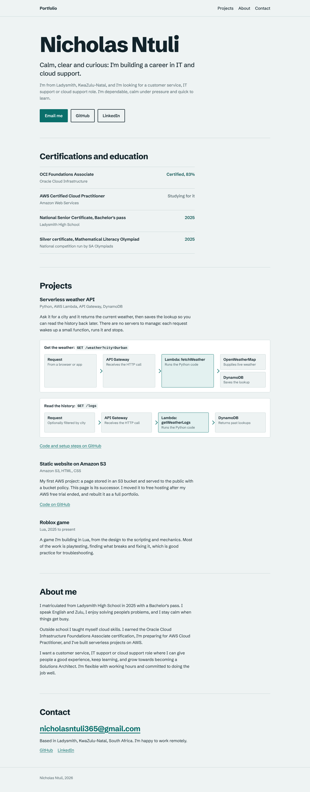
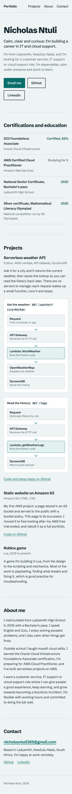

# Static Website on AWS S3

A personal portfolio site. It started as a static page hosted on Amazon S3, and it is now a full one-page portfolio hosted free on GitHub Pages.

**Live site:** https://nicholasntuli365.github.io/AWS-static-website/

## Screenshots

Desktop:

Phone:

## How it was first hosted on AWS

I first deployed this site on Amazon S3 in the Africa (Cape Town) region, `af-south-1`.

- **Amazon S3** stored and served the static HTML and CSS files.
- **An S3 bucket policy** (JSON) gave the public read access to the files.

The original S3 address no longer works because my AWS free trial ended. I moved the site to GitHub Pages so it stays online at no cost.

## What I learned

- Creating and configuring an S3 bucket for static website hosting
- Writing and applying an S3 bucket policy in JSON
- Tracking AWS Free Tier usage and setting up billing alerts
- Moving a static site to a different host when a free trial ends

## About the page

It is a single `index.html` file with the styles and font built in, so it has no dependencies and loads quickly. It works on phones and desktops and includes my certifications, projects, an About me section and contact links.

## My other AWS project

[Serverless weather API](https://github.com/nicholasntuli365/serverless-weather-api): a REST API built with AWS Lambda, API Gateway and DynamoDB.
